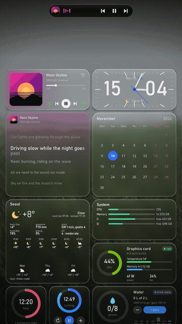
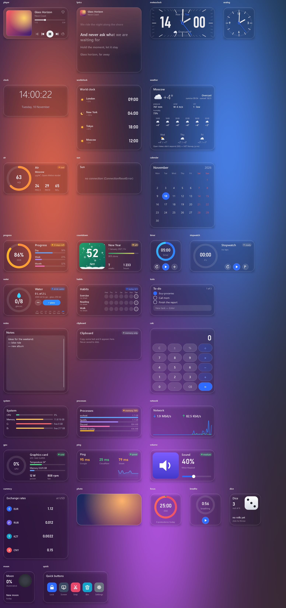
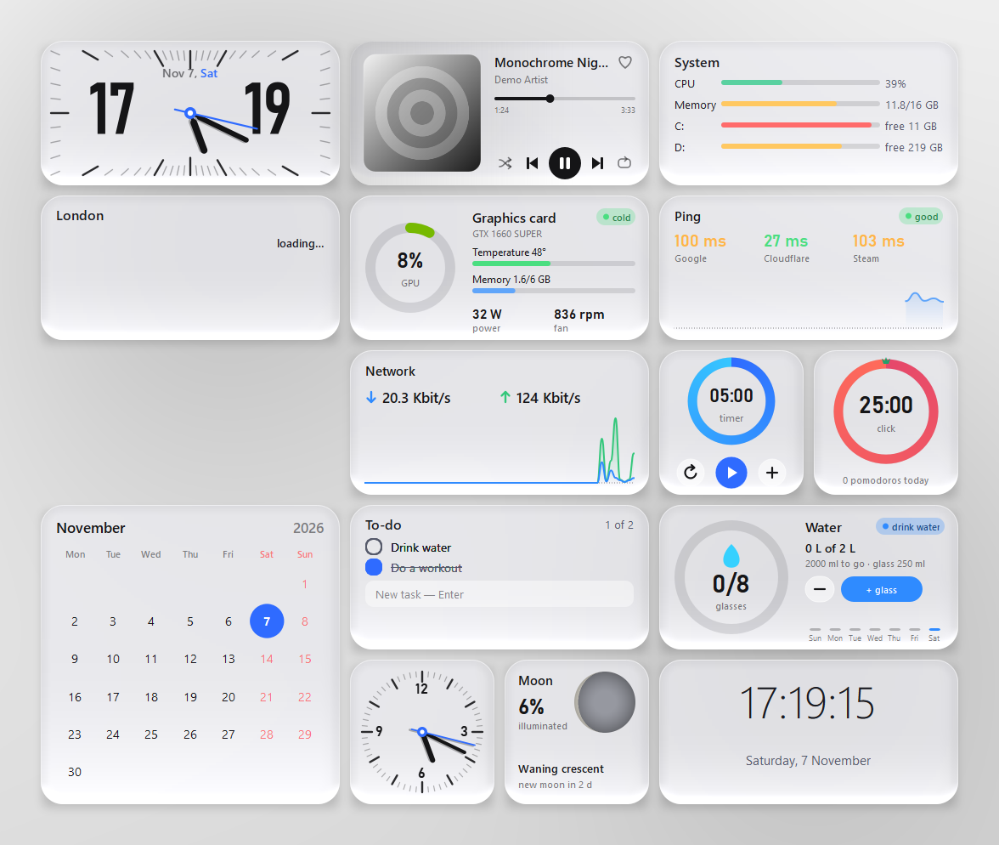
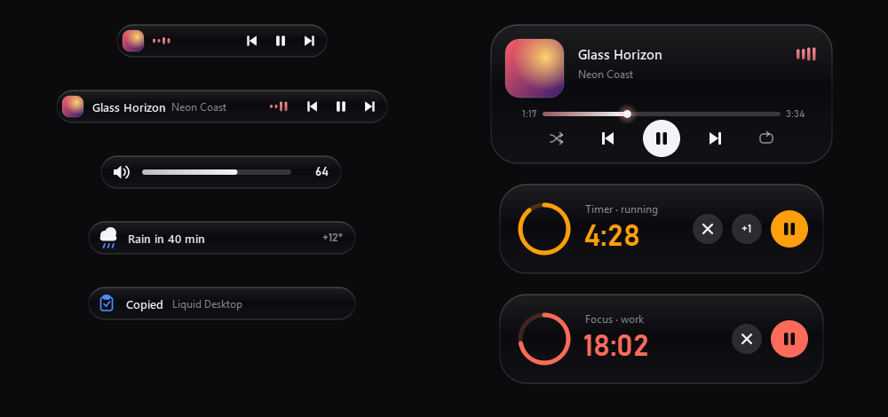
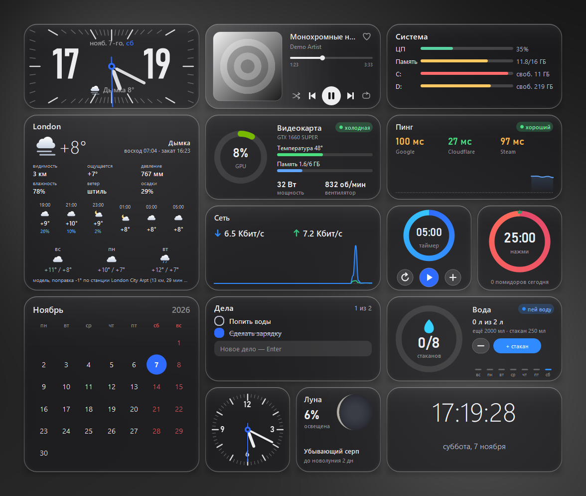
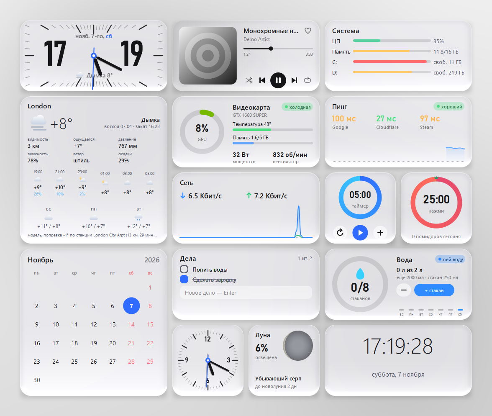
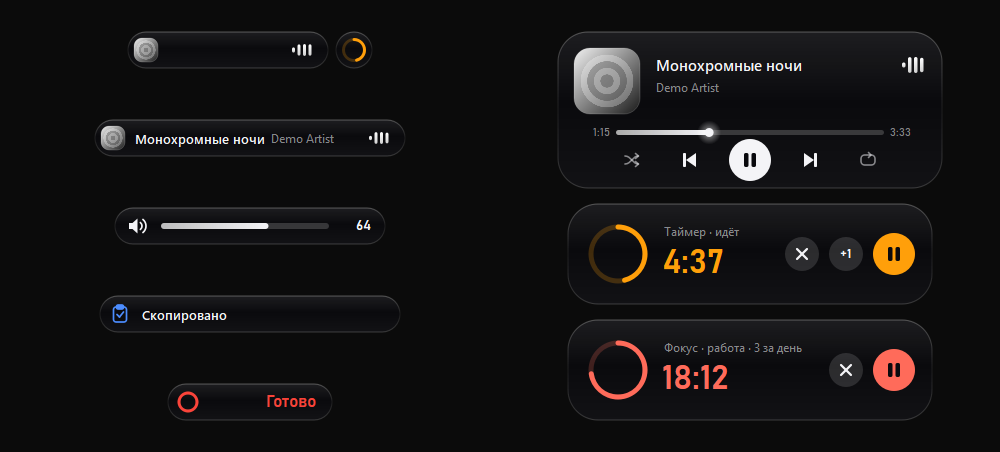

# Liquid Desktop

**Glass desktop widgets and a Dynamic Island for Windows**
**Стеклянные виджеты рабочего стола и «Динамический остров» для Windows**

[English](#english) · [Русский](#русский)

 

> [!WARNING]
> **Alpha version.** This is an early build — expect bugs, rough edges and changes between versions.
> **Альфа-версия.** Это ранняя сборка — возможны баги, недоделки и изменения между версиями.

---

## English

Liquid Desktop is two small open-source apps written in Python + PySide6:

- **Desktop Widgets** (`desktop-widgets`) — 34 widgets with live acrylic glass inspired by ColorOS 17:
  clock, weather clock, analog clock, weather, air quality, calendar, world clock, sun, moon, progress of the
  day/week/month, countdown, timer, stopwatch, pomodoro, breathing, water, habits, to-do, notes, clipboard,
  calculator, dice, photo, player and lyrics (Spotify and YouTube Music), system, processes, network,
  GPU (NVIDIA), ping, sound, currency, quick buttons, and **Claude** — a pixel pet that shows what
  Claude Code is doing right now (right click → **Connect to Claude Code** adds hooks to
  `~/.claude/settings.json`; a backup copy is saved next to it, and uninstalling removes the hooks).
- **Dynamic Island** (`dynamic-island`) — a glass capsule at the top of the main screen. It appears only when
  something is going on: music (with ⏮ ⏯ ⏭ right in the capsule), a timer, a pomodoro, rain or snow coming soon,
  volume changes, "copied", Caps Lock, audio device switch. Hover it to expand into a card with controls.

### Quick start — no Python needed

1. Open [**Releases**](https://github.com/Hirtou/liquid-desktop/releases/latest) and download **`LiquidDesktop-setup.exe`** (~65 MB).
   Python 3.12 and all libraries are already inside.
2. Run it. No admin rights needed: it installs into your user folder and adds **Liquid Desktop** to the Start menu.
   If Windows SmartScreen asks, click **More info → Run anyway** (the installer is not signed).
3. The widget catalog opens right after install. The Dynamic Island is in the Start menu too.

**Updates:** when a new build is out, the widgets' tray menu shows **Install update** — one click, your
widgets and settings stay. **Uninstall:** Windows Settings → Apps → Liquid Desktop.

Prefer no installer? Download **`LiquidDesktop-portable-win64.zip`** instead, unpack it anywhere and
double-click **`Start widgets.bat`** / **`Start Dynamic Island.bat`**. To remove it, quit both apps and delete the folder.

### Run from source (with your own Python)

- Windows 10 or 11
- [Python 3.12](https://www.python.org/downloads/) — during installation tick **"Add python.exe to PATH"**
- Internet on the first run (to install the libraries; weather, ping and currency also need it)

1. On this page click **Code → Download ZIP** and unpack it anywhere (for example, to the Desktop).
2. **Widgets:** open the `desktop-widgets` folder and double-click **`run.bat`**.
   The first run installs the libraries (a minute or two), then the **catalog** window opens.
   Turn widgets on with the switches on the cards. Drag a widget with the mouse; right-click it for its menu.
3. **Dynamic Island:** open the `dynamic-island` folder and double-click **`run.bat`**.
   The island lives at the top center of the main screen and shows up when music plays or a timer runs.
   Hover it to expand. Its settings: **tray icon → Settings…** or **right-click the island → Settings…**
4. Both apps keep running in the **system tray** (near the clock). Closing a window doesn't quit the app —
   use **Quit** in the tray menu.

Keep both folders next to each other: the island reads the timer, pomodoro and weather from the widgets.
If the island has **Start with Windows** on, the widgets also bring it back when it isn't running
(unless you quit it from the tray).

### Where things are

| What | Where |
|---|---|
| Turn widgets on/off, glass settings, theme | Widgets catalog (tray icon → **Open**) |
| Language (English / Русский) | Catalog header (top right). Island: Settings → **Language** |
| Start with Windows | Catalog → **Start with Windows**; island: tray menu |
| Move widgets when they are under desktop icons | Catalog → **Move widgets**, then **Done** |
| Settings of one widget (size, layout, city…) | Right-click the widget |
| Hide / show the island | **Ctrl+Alt+I** (change in `dynamic-island/config.json` → `"hotkey"`) |
| Volume | Mouse wheel over the island |
| Spotify "like" button (optional) | Right-click the Player → sign in (needs your own free Client ID from developer.spotify.com) |
| Weather source | Right-click Weather → **Weather source**: Open-Meteo (default, no key), MET Norway (yr.no, no key), Yandex Weather or OpenWeatherMap (your own key). If a site doesn't answer, the weather comes from another one |

Your settings are saved to `config.json` inside each folder. They are personal and are not part of the repository.

### Known limitations (alpha)

- Windows only. The GPU widget works with NVIDIA cards.
- Live acrylic captures the screen under the glass, so it uses a little CPU while the mouse moves nearby.
  Turn **Acrylic** off for a cheaper frosted look.
- "Under icons" mode doesn't work together with Wallpaper Engine.
- The island is shown on the main monitor only.
- Widgets and the island hide themselves from screen capture to see what's under the glass; for screenshots
  they show up automatically on PrtSc / Win+Shift+S.

### Building the installer and the portable zip

`powershell -ExecutionPolicy Bypass -File tools\make_portable.ps1` (needs Python 3.12 for pip and
[Inno Setup 6](https://jrsoftware.org/isinfo.php) for the installer: `winget install JRSoftware.InnoSetup`) →
`build\LiquidDesktop-setup.exe`, `build\LiquidDesktop-portable-win64.zip` and `build\version.json`
(upload all three to the release — the installed app compares `version.json` to offer updates).

### License

[MIT](LICENSE) — free to use, change and share. Contributions and bug reports are welcome.

---

## Русский

Liquid Desktop — две небольшие программы с открытым исходным кодом на Python + PySide6:

- **Виджеты** (`desktop-widgets`) — 34 виджета с живым акриловым стеклом в стиле ColorOS 17:
  часы, метеочасы, циферблат, погода, воздух, календарь, мировое время, солнце, луна, прогресс дня/недели/месяца,
  отсчёт, таймер, секундомер, помидор, дыхание, вода, привычки, дела, заметки, буфер, калькулятор, кубик, фото,
  плеер и слова песни (Spotify и YouTube Music), система, процессы, сеть, видеокарта (NVIDIA), пинг, звук,
  курсы валют, быстрые кнопки и **Клод** — пиксельный зверёк, который показывает, чем сейчас занят
  Claude Code (правый клик → **Подключить к Claude Code** добавляет хуки в `~/.claude/settings.json`;
  прежний файл сохраняется копией рядом, при удалении программы хуки убираются).
- **Динамический остров** (`dynamic-island`) — стеклянная капсула вверху главного экрана. Появляется, только
  когда что-то происходит: музыка (с ⏮ ⏯ ⏭ прямо в капсуле), таймер, помидор, скоро дождь или снег, громкость,
  «скопировано», Caps Lock, смена устройства звука. Наведи мышь — раскроется карточкой с кнопками.

### Быстрый старт — Python не нужен

1. Открой [**Releases**](https://github.com/Hirtou/liquid-desktop/releases/latest) и скачай **`LiquidDesktop-setup.exe`** (~65 МБ).
   Python 3.12 и все библиотеки уже внутри.
2. Запусти его. Права администратора не нужны: ставится в папку пользователя, в «Пуске» появится **Liquid Desktop**.
   Если SmartScreen спросит — **Подробнее → Выполнить в любом случае** (установщик без цифровой подписи).
3. После установки сразу откроется каталог виджетов. Динамический остров — тоже в «Пуске».

**Обновления:** когда выйдет новая сборка, в меню виджетов в трее появится **«Установить обновление»** — один клик,
виджеты и настройки останутся. **Удалить:** Параметры Windows → Приложения → Liquid Desktop.

Без установщика: скачай **`LiquidDesktop-portable-win64.zip`**, распакуй куда удобно и дважды щёлкни
**`Start widgets.bat`** / **`Start Dynamic Island.bat`**. Удалить — выйти из обеих программ и стереть папку.

### Запуск из исходников (со своим Python)

- Windows 10 или 11
- [Python 3.12](https://www.python.org/downloads/) — при установке поставь галочку **«Add python.exe to PATH»**
- Интернет при первом запуске (поставить библиотеки; погоде, пингу и курсам он нужен и дальше)

1. Вверху этой страницы нажми **Code → Download ZIP** и распакуй куда удобно (например, на рабочий стол).
2. **Виджеты:** открой папку `desktop-widgets` и дважды щёлкни **`run.bat`**.
   Первый запуск ставит библиотеки (минута-две), потом откроется окно **каталога**.
   Включай виджеты переключателями на карточках. Виджет таскается мышью, правый клик по нему — меню.
3. **Динамический остров:** открой папку `dynamic-island` и дважды щёлкни **`run.bat`**.
   Остров живёт вверху по центру главного экрана и появляется, когда играет музыка или идёт таймер.
   Наведи мышь — раскроется. Настройки: **значок в трее → Настройки…** или **правый клик по острову → Настройки…**
4. Обе программы работают в **трее** (у часов). Закрытое окно не выключает программу —
   выйти можно через **Выход** в меню значка.

Держи обе папки рядом: остров берёт таймер, помидор и погоду из виджетов.
Если у острова включено **Запускать с Windows**, виджеты сами поднимут его, когда он не запущен
(кроме случая, когда ты вышел из него через трей).

### Что где

| Что | Где |
|---|---|
| Включить/выключить виджеты, стекло, тема | Каталог виджетов (значок в трее → **Открыть**) |
| Язык (English / Русский) | Шапка каталога (справа вверху). Остров: Настройки → **Язык** |
| Запуск вместе с Windows | Каталог → **Запускать с Windows**; остров — меню значка в трее |
| Подвинуть виджеты, когда они под ярлыками | Каталог → **Двигать виджеты**, потом **Готово** |
| Настройки одного виджета (размер, вид, город…) | Правый клик по виджету |
| Спрятать / вернуть остров | **Ctrl+Alt+I** (сменить — `dynamic-island/config.json` → `"hotkey"`) |
| Громкость | Колесо мыши над островом |
| Сердечко «в любимые» Spotify (по желанию) | Правый клик по плееру → войти (нужен свой бесплатный Client ID на developer.spotify.com) |
| Откуда погода | Правый клик по погоде → **Откуда погода**: Open-Meteo (по умолчанию, без ключа), MET Norway (yr.no, без ключа), Яндекс Погода или OpenWeatherMap (свой ключ). Сайт не ответил — погода берётся с другого |

Настройки сохраняются в `config.json` в каждой папке. Они личные и в репозиторий не попадают.

### Ограничения (альфа)

- Только Windows. Виджет «Видеокарта» — для карт NVIDIA.
- Живой акрил снимает экран под стеклом, поэтому немного нагружает процессор, пока рядом двигается мышь.
  Выключи **Акрил** — будет более дешёвая изморозь.
- Режим «Под ярлыками» не работает вместе с Wallpaper Engine.
- Остров показывается только на главном мониторе.
- Виджеты и остров прячутся от захвата экрана, чтобы видеть, что под стеклом; на скриншотах они появляются
  сами при PrtSc / Win+Shift+S.

### Лицензия

[MIT](LICENSE) — можно свободно пользоваться, менять и делиться. Сообщения о багах и правки приветствуются.

 

